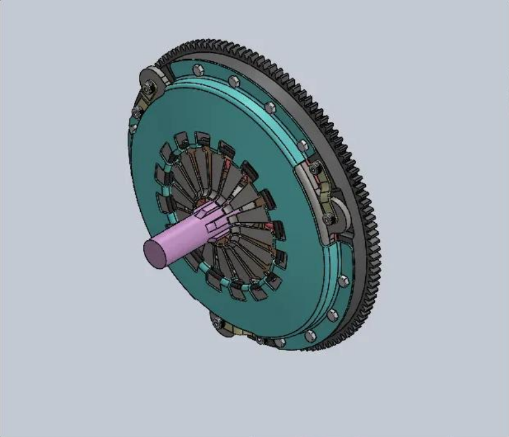
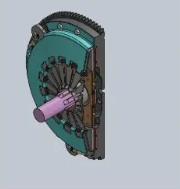
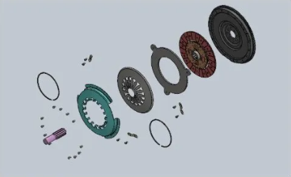
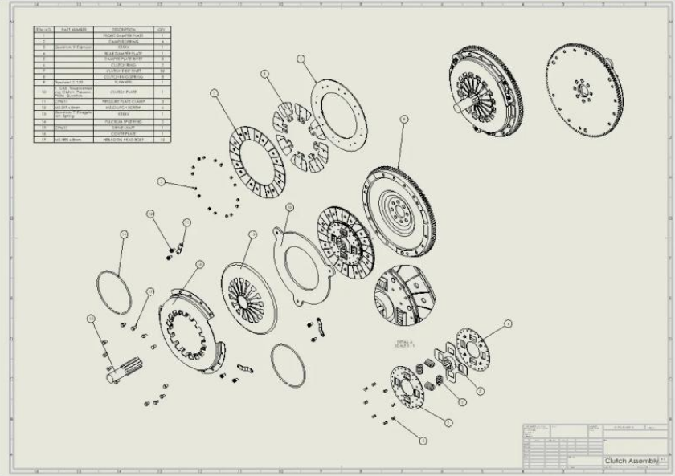

# Single-Plate Automotive Clutch Assembly

**University coursework | SolidWorks | Parametric CAD and mechanical assembly**

A detailed CAD model of a single-plate automotive clutch, developed from individual parts to demonstrate component modelling, mechanical mating, rotational relationships and engineering drawing production.

## Project overview

The project focused on building a mechanically representative clutch assembly rather than simply producing an exterior render. Approximately **40 individual components** were modelled or assembled, including the flywheel, friction disc, pressure plate, diaphragm spring, housing and associated hardware.

**Main deliverables**
- Parametric SolidWorks part models and a complete constrained assembly
- Mechanical mates defining concentricity, axial position and intended motion
- Sectioned assembly view for checking internal component arrangement
- Exploded assembly for illustrating component relationships
- Engineering assembly drawing with a title block, balloon callouts and bill of materials (BOM)

## 1. Component modelling

The assembly was constructed from individual parts before they were combined into the clutch system.

| Component | Role in the clutch |
| --- | --- |
| **Flywheel** | Rotating surface against which the friction disc engages |
| **Friction disc** | Frictional interface transmitting torque when clamped |
| **Pressure plate** | Applies clamping force to the disc |
| **Diaphragm spring** | Provides the spring mechanism for clutch engagement |
| **Housing** | Supports and locates the pressure-plate assembly |
| **Standard fasteners** | Connect and retain components |

The major structural components were designed in SolidWorks. Standard fasteners and hardware were sourced from the SolidWorks library.

## 2. Assembly design and mechanical mates

**Key engineering considerations**
- **Concentric alignment:** align the friction disc, flywheel and other rotating components on the intended axis.
- **Axial constraints:** restrict unwanted translation while retaining the mechanical relationships required by the model.
- **Rotational relationships:** use assembly mates to reproduce the intended degrees of freedom and relative positioning.
- **Assembly structure:** check that component interfaces, placement and orientation are consistent.

The work prioritised a coherent constrained CAD assembly. It did not include experimental measurement of clutch torque transmission or dynamic engagement behaviour.

### Section view

The section view exposes the internal geometry and the relative locations of the friction disc, pressure plate and surrounding components, making the assembly easier to inspect than an exterior render alone.

## 3. Exploded assembly

The exploded view separates the components to communicate the clutch's structure, relative locations and assembly relationships.

## 4. Engineering drawing and BOM

The drawing includes:
- An assembly drawing and title block
- Component balloons and part identification
- A bill of materials (BOM)
- Views needed to communicate the structure of the assembly

These outputs were produced for technical communication and consideration of manufacturability. They do not constitute inspection or fabrication records.

## 5. Engineering lessons

- **Parametric design:** model parts so geometry and assembly intent remain manageable when dimensions change.
- **Mechanical constraints:** correct mates are essential to demonstrating meaningful geometry and motion relationships.
- **Verification through sections:** internal geometry needs inspection, not only attractive rendered views.
- **Engineering documentation:** exploded views, callouts and a BOM make an assembly understandable to someone who did not build the CAD model.

## Scope and limitations

**Completed:** SolidWorks components, constrained assembly, section view, exploded view and engineering drawing with BOM.

**Not demonstrated:** Physical fabrication, clutch engagement or transmitted-torque testing, thermal/friction analysis, fatigue life or quantitative mechanical validation. The project is a **CAD and assembly coursework exercise**, not a manufactured clutch.

## Related links
- [Engineering portfolio home](https://farhan10904.github.io/engineering-portfolio/)

*The four image files used in this README belong in the repository's `Images/` folder. The images come from the original project documentation.*
